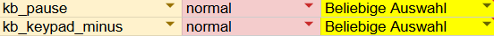

# NoHandsNeeded

[English](README.md) · **Deutsch**

Aktuelle Version: **1.02**. Download unter [Releases](https://github.com/ichmml/nohandsneeded/releases).

Eine Bildschirmtastatur für Windows, gebaut für Menschen, die den PC ohne Hände bedienen,
zum Beispiel mit einer Mundsteuerung (Quadstick), Kopfmaus oder Augensteuerung.
Ziel: so wenig Klicks wie möglich.

Warum NoHandsNeeded? Der Name ist Englisch und heißt „keine Hände nötig“. Genau dafür ist die Tastatur gebaut: für alle, die den PC ohne Hände bedienen, zum Beispiel mit einem Mundjoystick wie dem Quadstick, einer Kopfmaus oder mit den Augen.

## Was sie kann

- **Klaut nie den Fokus.** Was man tippt, landet immer im richtigen Programm.
- **Eigener Knopf in der Taskleiste** mit dem Tastatur-Symbol: Ein Klick öffnet die Tastatur immer ganz (auch aus dem eingeklappten runden Knopf), der Fokus geht sofort zurück ins Programm.
- **11 Sprachen eingebaut:** Deutsch, Englisch, Niederländisch, Französisch, Dänisch, Polnisch, Tschechisch, Italienisch, Spanisch, Türkisch, Russisch. Tastenlayout passend zur Sprache, Vorschläge auch ohne Akzente ("cafe" findet "café").
- **Oberfläche in der Windows-Sprache** und eine Einführung zum Durchklicken beim ersten Start.
- **Lernt mit:** neue Wörter, Lieblingswörter, typische Wortfolgen, die eigene Schreibweise und Zahlen wie Geburtsdatum, Handynummer, Kundennummer oder IBAN (nur gültige), schon nach dem ersten Mal vorgeschlagen. Auf Wunsch auch aus eigenen Texten (Ordner mit .txt, .md, .docx, Mails). Gespeichert wird nur Statistik, alles bleibt auf dem PC.
- **Merkt sich E-Mail-Adressen:** einmal tippen, beim nächsten Mal nach 3 Buchstaben vorgeschlagen. In Feldern für E-Mail oder Benutzername stehen die Adressen sofort oben.
- **Passwort-Tresor:** In Passwortfeldern stehen die gespeicherten Passwörter oben, ein Klick tippt sie ein. Neu getippte Passwörter kann man mit einem Klick speichern, sichere Passwörter erzeugen. Verschlüsselt mit Windows (DPAPI), optional mit PIN. Nie in den Wortvorschlägen, nie über die Zwischenablage.
- **Sichern und übertragen:** Gelerntes, eigene Begriffe, Makros und auf Wunsch die Passwörter als eine `.nohands`-Datei exportieren und auf dem zweiten PC importieren. Mit Passwörtern immer verschlüsselt (AES-256), beim Import wird zusammengeführt statt überschrieben.
- **Verweilklick:** Eine Taste löst aus, wenn man kurz darauf bleibt.
- **Sondertasten für die nächste Taste:** Strg, Alt, Shift, Win und AltGr einmal antippen gilt für die nächste Taste, zweimal antippen schaltet sie wieder aus. Shift bleibt zum Markieren über mehrere Pfeiltasten an. AltGr sitzt direkt rechts neben der Leertaste.
- **Sonderzeichen unten einstellbar:** von Haus aus ! ? : -, in den Einstellungen änderbar.
- **Getipptes Wort oben links in Rot**, Buchstabe für Buchstabe, auch mit Sonderzeichen ("s!add" bleibt stehen). Neue Wörter merkt sie sich mit einem Klick, Passwörter erscheinen als Punkte (👁 zeigt sie kurz). Im eigenen Tresor-Fenster sieht man ein neues Passwort beim Tippen im Klartext.
- **Groß/Klein-Taste** (abc ↑ / ABC ↓), die das letzte Wort nachträglich groß- oder kleinschreibt.
- **Merkt sich das angefangene Wort pro Fenster:** Fenster wechseln und zurück, einfach weiterschreiben.
- **Zeigt echte Tastendrücke** (z. B. vom Quadstick) rot auf der Tastatur an.
- **Makros:** Textbausteine, Tastenfolgen und Programme starten, alles mit einem Klick. Man kann sie aufnehmen statt programmieren.
- **Globale Kürzel**, zum Beispiel für eine Taste am Quadstick.
- **Frei verschieben und skalieren**, auch durch langes Draufbleiben auf einer Taste, über mehrere Bildschirme mit unterschiedlicher Skalierung.
- Läuft **offline**, nichts wird gesendet.

## Quadstick

Zwei globale Kürzel sind voreingestellt und funktionieren auch, wenn ein anderes Programm vorne ist:

| Taste | Funktion |
|---|---|
| Pause | Tastatur ein- und ausblenden |
| Ziffernblock Minus | Makroleiste öffnen |

So sieht die Belegung im Quadstick-Konfigurationsblatt aus:

In der gelben Spalte den gewünschten Eingang wählen (z. B. `mp_triple_puff`), dann die Konfiguration
auf den Quadstick laden. F13 bis F24 kann der Quadstick nicht senden.

## Installation

1. Unter [Releases](../../releases) die neueste `NoHandsNeeded.exe` herunterladen.
2. In einen eigenen Ordner legen, zum Beispiel `C:\Tools\NoHandsNeeded`, und starten.
   Es muss nichts installiert werden. .NET Framework 4.8 ist in Windows 10 und 11 schon enthalten.

**Umstieg von der alten `Tastatur.exe`:** `NoHandsNeeded.exe` in denselben Ordner legen und die alte exe löschen.
Beim ersten Start wird der Ordner `Tastatur-Daten` in `NoHandsNeeded-Daten` umbenannt, alles Gelernte bleibt.

**Windows-Warnung "Der Computer wurde durch Windows geschützt":** Die Datei ist nicht signiert.
Rechtsklick auf `NoHandsNeeded.exe` → Eigenschaften → unten den Haken bei **"Zulassen"** setzen → OK.
Danach startet sie ohne Meldung. Alternativ "Weitere Informationen" → "Trotzdem ausführen".

Die ausführliche Anleitung gibt es in allen 11 Sprachen im Ordner [`Anleitung`](Anleitung) (deutsch: [Anleitung-de.txt](Anleitung/Anleitung-de.txt)). In der Tastatur öffnet sie sich über "📖 Anleitung öffnen" ganz oben in den Einstellungen.

## Sprachen der Oberfläche

Die Texte liegen in [`Resources/Texte`](Resources/Texte), eine Datei pro Sprache: deutscher Text, Tabulator, Übersetzung.
Die Anleitungen liegen in [`Anleitung`](Anleitung). Die Übersetzungen hat eine KI erstellt. **Muttersprachler: Korrekturen gern als Pull Request oder Issue.**
Fehlt ein Text, erscheint er auf Englisch.

## Sperrbildschirm (Installer)

Damit die Tastatur auf dem Windows-Sperrbildschirm erscheint (z. B. zum Eingeben der PIN), braucht es eine signierte, installierte Version:

1. `build.cmd` ausführen. Es entsteht zusätzlich `installer\NoHandsNeededAT.exe` (mit `uiAccess`).
2. `NoHandsNeededAT.exe` mit einem Code-Zertifikat signieren (Beispielzeile in `build.cmd`).
3. Mit [Inno Setup](https://jrsoftware.org/isinfo.php) `installer\NoHandsNeeded.iss` bauen. Der Installer legt die Tastatur nach `C:\Program Files\NoHandsNeeded` und meldet sie als Hilfsmittel bei Windows an.
4. In der Tastatur: Einstellungen → Sonstiges → Sperrbildschirm → "Auf dem Sperrbildschirm anzeigen".

Auf dem Sperrbildschirm läuft nur das Tippen, ohne Tresor, Makros, Lernen und Vorschläge.

## Selbst bauen

Auf jedem Windows-PC ohne weitere Installation: `build.cmd` doppelklicken.
Es benutzt den C#-Compiler, der mit Windows mitkommt, und erzeugt `NoHandsNeeded.exe`.

## Unterstützen

Die Tastatur ist kostenlos und bleibt es. Wenn sie dir hilft, freue ich mich über eine Spende:

## Lizenz

- **Programmcode:** MIT-Lizenz, siehe [LICENSE](LICENSE)
- **Wortlisten** (in der .exe und im Ordner `sprachpakete`): abgeleitet aus
  [wordfreq](https://github.com/rspeer/wordfreq) von Robyn Speer, Daten unter
  [CC BY-SA 4.0](https://creativecommons.org/licenses/by-sa/4.0/). Die Wortlisten stehen
  deshalb ebenfalls unter CC BY-SA 4.0. Details: [LIZENZEN-WORTLISTEN.md](LIZENZEN-WORTLISTEN.md)
