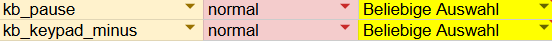

# NoHandsNeeded

**English** · [Deutsch](README.de.md)

Current version: **1.01**. Download under [Releases](https://github.com/ichmml/nohandsneeded/releases).

An on-screen keyboard for Windows, built for people who use the PC without their hands,
for example with a mouth controller (Quadstick), a head mouse or eye tracking.
Goal: as few clicks as possible.

Why NoHandsNeeded? Because that is exactly what this keyboard is built for: using the PC without your hands, for example with a mouth joystick like the Quadstick, a head mouse or your eyes.

Manual in 11 languages: [English](Anleitung/Anleitung-en.txt) · [Deutsch](Anleitung/Anleitung-de.txt) ·
[Nederlands](Anleitung/Anleitung-nl.txt) · [Français](Anleitung/Anleitung-fr.txt) · [Dansk](Anleitung/Anleitung-da.txt) ·
[Polski](Anleitung/Anleitung-pl.txt) · [Čeština](Anleitung/Anleitung-cs.txt) · [Italiano](Anleitung/Anleitung-it.txt) ·
[Español](Anleitung/Anleitung-es.txt) · [Türkçe](Anleitung/Anleitung-tr.txt) · [Русский](Anleitung/Anleitung-ru.txt)

## What it does

- **Never steals the focus.** What you type always lands in the right program.
- **Own taskbar button** with the keyboard icon: one click always opens the keyboard fully (also from the collapsed round button), the focus goes straight back to your program.
- **11 languages built in:** German, English, Dutch, French, Danish, Polish, Czech, Italian, Spanish, Turkish, Russian. Key layout matching the language, suggestions also without accents ("cafe" finds "café").
- **Interface, introduction and manual in the Windows language**, English otherwise.
- **Learns as you write:** new words, favourite words, typical word sequences, your own spelling and numbers such as a birth date, phone number, customer number or IBAN (only valid ones), suggested right after the first time. Optionally also from your own texts (folder with .txt, .md, .docx, mails). Only statistics are stored, everything stays on the PC.
- **Remembers e-mail addresses:** type one once, next time it is suggested after 3 letters. In e-mail and user name fields the addresses appear right away.
- **Password vault:** in password fields your saved passwords appear at the top, one click types them. Newly typed passwords can be saved with one click, secure passwords can be generated. Encrypted with Windows (DPAPI), optional PIN. Never in the word suggestions, never through the clipboard.
- **Back up and transfer:** export learned data, custom terms, macros and, if you like, the passwords as one `.nohands` file and import it on your second PC. With passwords always encrypted (AES-256), importing merges instead of overwriting.
- **Dwell click:** a key triggers when you stay on it briefly.
- **Sticky modifier keys:** tap Ctrl, Alt, Shift, Win or AltGr once for the next key, twice to lock. AltGr sits right next to the space bar.
- **Editable special characters** in the bottom row: ! ? : - by default.
- **Typed word in red at the top left**, letter by letter, also with special characters ("s!add" stays). New words are remembered with one click, passwords appear as dots (👁 shows them briefly). In the keyboard's own vault window a new password is shown in plain text while typing.
- **Case key** (abc ↑ / ABC ↓) that capitalizes or lowercases the last word afterwards.
- **Remembers the started word per window:** switch windows and back, and simply keep writing.
- **Shows real key presses** (e.g. from the Quadstick) in red on the keyboard.
- **Macros:** text snippets, key sequences and starting programs, all with one click. Record them instead of programming.
- **Global shortcuts**, for example for a Quadstick key.
- **Move and resize freely**, also by staying on a key, across several screens with different scaling.
- Works **offline**, nothing is sent.

## Quadstick

Two global shortcuts are preset and also work when another program is in front:

| Key | Function |
|---|---|
| Pause | show/hide the keyboard |
| Numpad minus | open the macro bar |

This is what the assignment looks like in the Quadstick configuration sheet:

Choose the input you want in the yellow column (e.g. `mp_triple_puff`), then load the configuration
onto the Quadstick. The Quadstick cannot send F13 to F24.

## Installation

1. Download the latest `NoHandsNeeded.exe` under [Releases](../../releases).
2. Put it in its own folder, for example `C:\Tools\NoHandsNeeded`, and run it.
   Nothing to install. .NET Framework 4.8 is already part of Windows 10 and 11.

**Coming from the old `Tastatur.exe`?** Put `NoHandsNeeded.exe` into the same folder and delete the old exe.
On the first start your folder `Tastatur-Daten` is renamed to `NoHandsNeeded-Daten`, everything learned stays.

**Windows warning "Windows protected your PC":** the file is not signed.
Right-click `NoHandsNeeded.exe` → Properties → tick **"Unblock"** at the bottom → OK.
After that it starts without the message. Alternatively "More info" → "Run anyway".

The detailed manual is in the [`Anleitung`](Anleitung) folder in all 11 languages. Inside the keyboard it
opens via "📖 Open manual" at the very top of the settings.

## Interface languages

The texts are in [`Resources/Texte`](Resources/Texte), one file per language: German text, tab, translation.
The manuals are in [`Anleitung`](Anleitung). The translations were made by an AI.
**Native speakers: corrections are welcome as a pull request or issue.**
If a text is missing, it appears in English.

## Lock screen (installer)

For the keyboard to appear on the Windows lock screen (e.g. to type the PIN), it has to be a signed, installed version:

1. Run `build.cmd`. It additionally creates `installer\NoHandsNeededAT.exe` (with `uiAccess`).
2. Sign `NoHandsNeededAT.exe` with a code signing certificate (example line in `build.cmd`).
3. Build `installer\NoHandsNeeded.iss` with [Inno Setup](https://jrsoftware.org/isinfo.php). The installer follows the Windows language, puts the keyboard into `C:\Program Files\NoHandsNeeded` and registers it with Windows as an assistive technology.
4. In the keyboard: Settings → Other → Lock screen → "Show on lock screen".

On the lock screen only typing works, without vault, macros, learning and suggestions.

## Build it yourself

On any Windows PC without further installation: double-click `build.cmd`.
It uses the C# compiler that comes with Windows and creates `NoHandsNeeded.exe`.

## Support

The keyboard is free and will stay free. If it helps you, I'd be happy about a donation:

## License

- **Program code:** MIT license, see [LICENSE](LICENSE)
- **Word lists** (in the .exe and in the `sprachpakete` folder): derived from
  [wordfreq](https://github.com/rspeer/wordfreq) by Robyn Speer, data under
  [CC BY-SA 4.0](https://creativecommons.org/licenses/by-sa/4.0/). The word lists are
  therefore also under CC BY-SA 4.0. Details: [LIZENZEN-WORTLISTEN.md](LIZENZEN-WORTLISTEN.md)
